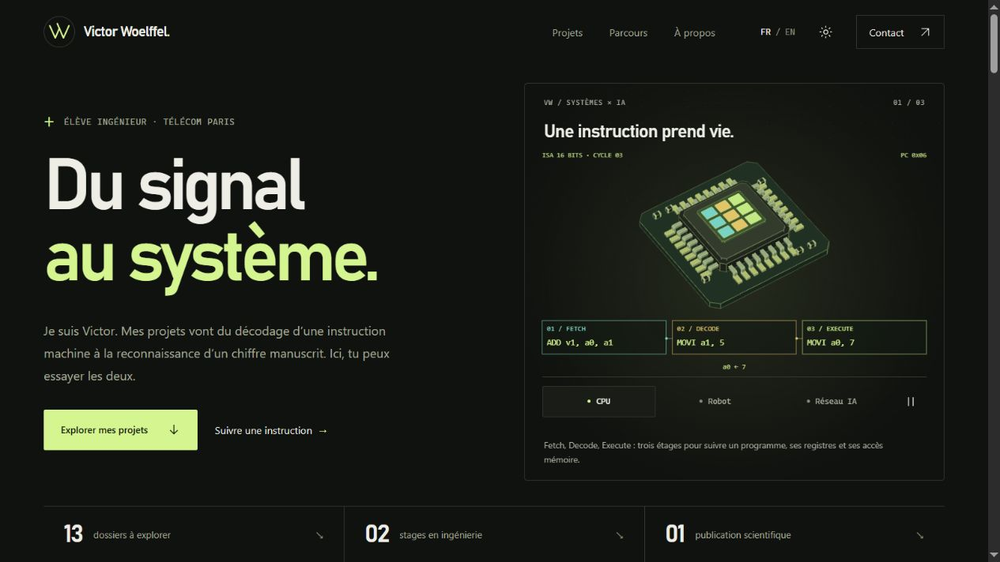

# Victor Woelffel — Du signal au système

Portfolio personnel bilingue, conçu autour de l’intelligence artificielle, des systèmes embarqués et de la robotique.



## Ouvrir le site

Sous Windows, double-cliquer sur **Ouvrir_Portfolio.cmd**. Le lanceur reconstruit le site si Node.js est installé, puis ouvre la version locale dans le navigateur.

La version déjà construite est aussi accessible en ouvrant **dist/index.html**. Elle fonctionne directement depuis les fichiers, sans installation et sans serveur.

Pour développer, avec Node.js 20 ou supérieur (Node 24 utilisé pour la vérification) :

```sh
npm run dev
```

Ouvrir l’adresse affichée : http://127.0.0.1:4173. Arrêter le serveur avec Ctrl+C. Aucune installation de dépendances n’est nécessaire.

## Ce que contient le portfolio

- Douze dossiers : projets académiques, projets techniques, hackathon et travail de recherche.
- Fiches détaillées, liens directs sous la forme `#project/optiframe`, navigation entre projets.
- Filtres par domaine et recherche tolérant les accents et les ligatures.
- Deux stages, formation, publication scientifique, association et centres d’intérêt.
- Français et anglais, thème sombre et thème clair.
- Navigation qui s’efface en descendant et réapparaît en remontant, animations désactivables et réduction des mouvements respectée.
- Illustrations SVG originales et deux scènes 3D : processeur avec pipeline et bras robotisé qui empile trois cubes, plus un réseau neuronal en 2D.
- CV PDF existants et validés, adaptés à la langue sélectionnée.
- Rapport d’architecture RISC-V et poster Q-learning téléchargeables depuis leurs fiches.
- Atelier de reconnaissance de chiffres : dessin, entrée 28 × 28, activations et trois scores du CNN sauvegardé.
- Processeur pas à pas, interruption STM32 et transfert d’un pixel Avalon / FIFO dans les fiches concernées.
- Aucun service distant nécessaire à l’affichage, aucune statistique externe et aucun cookie de suivi.

## Deux liens de présentation

L’accueil ordinaire ouvre le CPU et tous les projets. Deux variantes servent à partager un parcours ciblé :

- `http://127.0.0.1:4173/?focus=embedded` : CPU et filtre des projets embarqués.
- `http://127.0.0.1:4173/?focus=ai` : réseau neuronal et filtre des projets IA.

Les autres vues et projets restent accessibles via les boutons et filtres habituels. Les paramètres fonctionnent aussi sur un hébergement statique.

## Modifier

| Fichier | Rôle |
| --- | --- |
| `content.js` | Textes français/anglais, projets, compétences et liens |
| `index.html` | Structure sémantique et métadonnées |
| `styles.css` | Identité visuelle, responsive et thèmes |
| `app.js` | Navigation, recherche, fiches et scènes |
| `scene.js` / `solid-renderer.js` | Mise en scène, éclairage, annotations et rendu WebGL avec profondeur |
| `processor-engine.js` / `processor-lab.js` | ISA personnalisée 16 bits et visite interactive du pipeline |
| `hardware-engines.js` / `hardware-labs.js` | Interruptions STM32 et lecture Avalon vers une FIFO puis l’écran |
| `neural-scene.js` | Vue 2D des activations du CNN |
| `scene-models.js` | Géométrie du processeur, bras robotisé et cinématique directe |
| `design/` | Modèles OBJ/MTL importables dans Blender |
| `visuals.js` | Schémas vectoriels des projets |
| `assets/` | CV, rapports de projets, archive de code, poids du CNN et visuels |
| `digit-engine.js` / `digit-lab.js` | Inférence du CNN de chiffres et atelier de dessin local |
| `docs/CONTENT_SOURCES.md` | Sources et limites factuelles |
| `docs/VERIFICATION.md` | Vérifications réalisées et limites connues |

Les textes représentent Victor à la date du 4 novembre 2026. Mettre à jour le statut des études lorsqu’il change. Le site présente les projets et ne comporte plus de recherche de stage. La base personnelle du dépôt CV reste la référence factuelle.

## Vérifier et construire

```sh
npm run check
npm test
npm run build
npm run preview
```

Le build rassemble les modules dans un script classique pour permettre l’ouverture de `dist/index.html` depuis le disque. Le serveur est limité à la boucle locale. Les fichiers cachés et les chemins sortant du dossier servi sont refusés.

Les préférences de langue et de thème sont mémorisées dans le stockage local du navigateur. Le site continue à fonctionner lorsque ce stockage est indisponible.

## Modèles 3D

Les deux figures sont des modèles originaux. Le bouton « CPU » montre la puce et un programme dans les étages Fetch / Decode / Execute. « Robot » saisit trois cubes, les empile puis recommence. Le rendu WebGL utilise un tampon de profondeur pour éviter les faces qui passent à travers d’autres volumes. « Réseau IA » reste une visualisation 2D du CNN réel. Le bouton de pause arrête les animations.

Les géométries se régénèrent pour Blender avec `npm run export-models`. Voir [les notes des modèles](design/README.md).

## Démo de reconnaissance de chiffres

La fiche `#project/neural-networks` charge les poids du CNN seulement à son ouverture. Le réseau s’exécute localement en JavaScript, sans serveur d’inférence, sans compte et sans transmission du dessin. Le modèle comporte 225 034 paramètres. Le prototype NumPy et l’interface Pygame d’origine restent accessibles dans l’archive de code.

Les résultats correspondent aux scores du modèle sur le dessin, pas à une mesure de précision. Voir [les notes du modèle](docs/DIGIT_MODEL.md) pour l’origine des poids, le prétraitement adapté et la vérification numérique.

## Git et GitHub

Les sources du portfolio sont disponibles dans [Victor11W/portfolio](https://github.com/Victor11W/portfolio). Le site est hébergé sur [Télécom Paris](https://perso.telecom-paristech.fr/vwoelffel-23/).

La branche publique est `codex/public-portfolio`. Son historique commence avec un instantané des sources vérifiées, après retrait des documents confidentiels. L’ancien historique de travail est conservé uniquement en local sur `codex/portfolio` ; ne pas publier cette branche historique.

Ce dépôt est distinct du dépôt privé des CV et candidatures. Les sorties de build, les captures de vérification, les secrets et les fichiers temporaires sont ignorés.

Si Git signale une différence de propriétaire sur ce dossier Windows, utiliser `npm run git -- status` (ou toute autre commande Git après `--`). Cette commande fait confiance uniquement à ce dépôt, pour cette invocation, sans modifier les réglages Git globaux.

Après avoir enregistré des modifications sur la branche publique :

```sh
git push origin codex/public-portfolio
```

Envoyer uniquement cette branche. Les options `--all` et `--mirror` ne doivent pas être utilisées : elles incluraient l’historique local qui n’est pas destiné à la publication.

Le workflow GitHub Actions vérifie les sources, lance les tests et construit le site. Il ne publie rien sur l’hébergement SSH.

## Publier et mettre à jour

Le portfolio a été mis en ligne le 4 novembre 2026 : **https://perso.telecom-paristech.fr/vwoelffel-23/**. L’adresse avec `perso.telecom-paris.fr` redirige vers celle-ci.

1. Modifier les sources de ce dossier. Les textes bilingues sont dans `content.js`, les styles dans `styles.css`, la structure dans `index.html` et les interactions dans `app.js` et les modules associés.
2. Double-cliquer sur **Ouvrir_Portfolio.cmd** pour prévisualiser les modifications localement.
3. Double-cliquer sur **Publier_Portfolio.cmd** pour publier. Saisir le mot de passe uniquement lorsque la demande SSH du serveur apparaît dans cette fenêtre. Aucun caractère ne s’affiche pendant la saisie. Laisser la fenêtre ouverte jusqu’au résultat final.

Le lanceur contrôle le JavaScript, exécute les tests et construit `dist/`. Il envoie uniquement ce dossier, vérifie l’intégrité de l’archive, sauvegarde le site précédent dans le dossier personnel du serveur, met la nouvelle page en place puis contrôle en HTTPS les fichiers publiés. En cas d’échec de cette dernière vérification, le script restaure la sauvegarde. Les fichiers supplémentaires déjà présents sur le serveur sont conservés, à l’exception de l’ancien CV français : ce document retiré est déplacé dans la sauvegarde privée et son absence publique est vérifiée.

La même publication est disponible depuis un terminal :

```sh
npm run deploy
```

Pour vérifier et préparer une archive sans connexion SSH ni publication :

```sh
npm run deploy -- --dry-run
```

Les archives et scripts de préparation restent dans `outputs/deploy-*/`, ignoré par Git. Le nouveau lanceur a été vérifié en mode préparation et son script distant a passé le contrôle syntaxique du shell. La publication initiale a été effectuée et vérifiée séparément via SSH. Le lanceur a ensuite publié avec succès la mise à jour du portrait et de la contribution Emerton, après les 31 tests et une vérification HTTPS des fichiers.

Le serveur est `perso-vwoelffel-23.lxc.enst.fr`, accessible par `ssh.enst.fr`. Le dossier servi est `/srv/www/vwoelffel-23/`. Aucune installation ni modification d’Apache n’est nécessaire pour publier ce site statique. Les chemins des ressources sont relatifs et les métadonnées de partage utilisent l’URL publique.

```sh
ssh -J vwoelffel-23@ssh.enst.fr vwoelffel-23@perso-vwoelffel-23.lxc.enst.fr
```

La sauvegarde de la page initiale « site en construction » est conservée sur le serveur dans `/home/vwoelffel-23/.local/share/portfolio-deployments/2026-11-04.aF4XcL/previous-web.tar.gz`. Les publications suivantes affichent le chemin de leur propre sauvegarde. Le déploiement n’est pas déclenché automatiquement par les modifications locales ou par GitHub Actions : lancer la publication pour chaque nouvelle version à mettre en ligne.

## Direction visuelle

Un atelier d’ingénieur : fond encre, accent tilleul, grille fine, typographie expressive et schémas techniques. Les références demandées, [Dion Pieters](https://www.dionpieters.dev/) et [Brittany Chiang](https://brittanychiang.com/), ont servi à explorer la composition et la lisibilité. Le code et les illustrations ont été créés pour ce portfolio.

La typographie utilise les polices disponibles sur l’appareil (Bahnschrift/Arial, Segoe UI et Consolas). Aucun fichier de police propriétaire n’est distribué.

Code personnel de Victor Woelffel. Aucune licence de redistribution n’est accordée par défaut.
