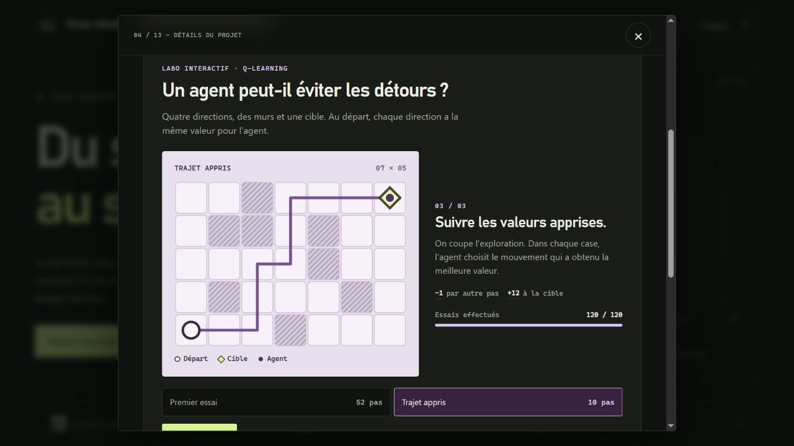

# Comparaison de la proposition — 4 novembre 2026

Version de référence : `76c1d99` sur `codex/public-portfolio`. La proposition reste sur sa branche ; GitHub fabrique l’archive de prévisualisation sans déployer le site.

## Parcours de lecture

- **Accueil :** faire défiler jusqu’aux projets. La navigation reste au début du document. Sur un écran de 390 px, le menu déplié repousse le titre sous ses liens.
- **CPU :** les trois étages affichent des instructions dès l’ouverture. Le dossier renvoie à la page du rapport où un décalage de deux bits est réécrit en deux additions. « Essayer la démo » passe directement au programme pas à pas.
- **Neurones :** le dossier fait la distinction entre l’extrait NumPy et le CNN sauvegardé. En anglais et en thème clair sur écran étroit, sélectionner le chiffre 7 donne la réponse calculée 7.
- **OptiFrame :** la figure imprimable est un export sur des contours de démonstration. Le lecteur peut vérifier l’échelle avec le repère de 10 mm.
- **Q-learning :** le premier épisode de la grille prend 52 pas. Après 120 épisodes, une évaluation sans exploration en prend 10. La graine fixe rend ce parcours reproductible. Ces chiffres ne mesurent pas l’agent Chartichaud du poster.
- **Emerton :** le graphique traduit la réduction de temps de 30 % en indice 100 → 70. Il ne publie ni temps absolu, ni données métier.

## Mesures locales

| Mesure | Référence | Proposition |
| --- | ---: | ---: |
| Entrée : HTML, JS initial, CSS initial, préférences, favicon | 225 769 octets | 180 745 octets |
| Mêmes fichiers, estimation gzip par fichier | 69 138 octets | 57 601 octets |

`node scripts/verify-build.mjs` après `npm run build` reproduit le calcul. Il exclut les ressources facultatives : poids du CNN (1,20 Mo), documents, portrait et ateliers. La compression réelle dépend du serveur. Le build contrôle la présence des pièces et impose un plafond de 68 Kio gzip pour cette entrée.

Un essai local a comparé le même mouvement du robot en WebGL sur une surface de **340 × 490 px**, avec un pointeur tactile simulé. Après chauffe, pendant 2,7 s par version, le navigateur a dessiné **162 images** sur la référence et **81** sur la proposition : la cadence tactile est désormais plafonnée à 30 images/s. Le temps médian dans le callback de dessin est passé de **5,9 à 2,5 ms**, et le 95ᵉ percentile de **9,7 à 3,9 ms**. Aucune image n’a été dessinée durant les 400 ms où une fiche recouvrait la nouvelle scène. Cet essai mesure le travail côté JavaScript dans ce navigateur ; il ne mesure ni les performances d’un téléphone physique ni la consommation de sa batterie.

Les vérifications navigateur portent sur le build servi en HTTP local : vues ordinateur et mobile, français et anglais, deux thèmes, clavier, retour du focus après Échap, ouverture directe d’une fiche, lien inconnu, dessin du CNN, entraînement et relecture Q-learning. La préférence de réduction des animations donne accès à la relecture pas à pas. Le serveur SSH n’intervient pas dans ces essais.
